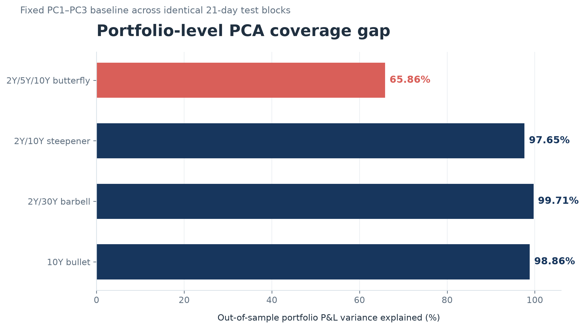
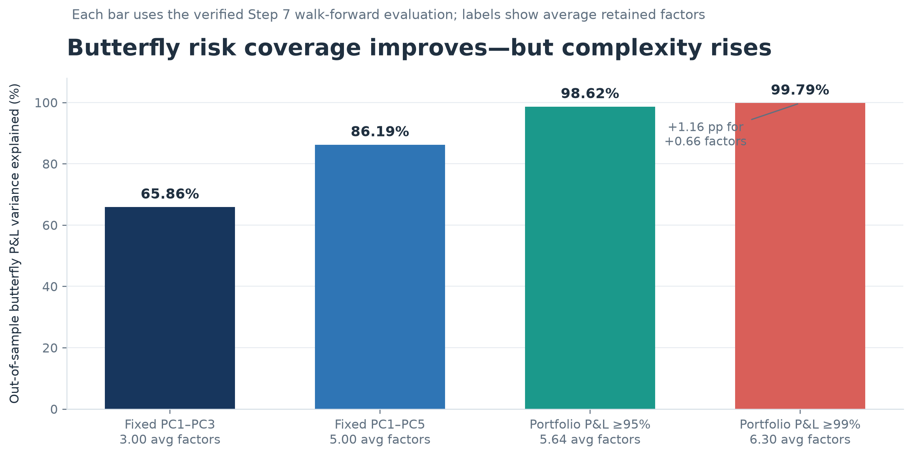
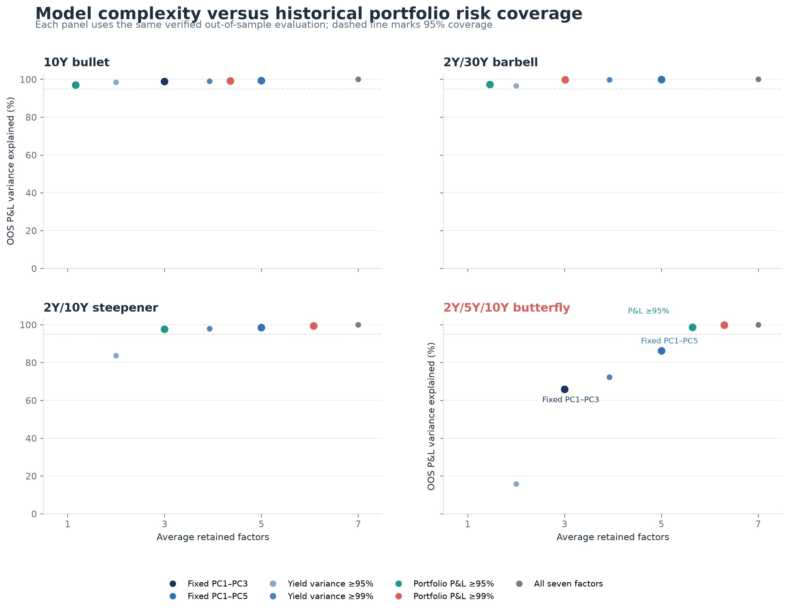

# Treasury PCA Risk Attribution

An independent quantitative research study of U.S. Treasury yield-curve risk attribution.

## Research question

Can a low-dimensional PCA model explain the P&L risk of every Treasury portfolio equally well, and does portfolio-specific factor selection provide enough additional out-of-sample coverage to justify greater complexity?

The study uses public U.S. Treasury par yields, daily yield changes, and four synthetic DV01 portfolios. It evaluates historical reconstruction—not returns, trading profitability, or genuine forecasting.

## Executive findings

- PC1–PC3 explain **98.91%** of overall seven-tenor yield-change variance, but only **65.86%** of the 2Y/5Y/10Y butterfly’s out-of-sample P&L variance.
- The butterfly is the clear risk-attribution outlier: PC1–PC3 produce a **0.584 normalized RMSE** and **$76,528 RMSE**, versus 0.054–0.153 normalized RMSE for the other portfolios.
- Step 7 confirms the complexity trade-off. For the butterfly, fixed PC1–PC5 raises coverage to **86.19%**; portfolio-aware 95% raises it to **98.62%** with **5.64 average factors**; portfolio-aware 99% reaches **99.79%** with **6.30 average factors**.
- Portfolio-aware selection is not uniformly better. Portfolio-aware 95% reduces coverage for the 10Y bullet to 96.95% and the 2Y/30Y barbell to 97.36%, while fixed PC1–PC3 already explains 98.86% and 99.71%, respectively.
- The practical conclusion is portfolio-specific: use a simple three-factor attribution for portfolios already well covered by PC1–PC3; consider portfolio-aware 95% for the butterfly when higher-order curve risk must be represented. These are retrospective research recommendations, not prospective model-selection claims.

### Figure 1 — Portfolio-level PCA coverage gap

The fixed three-factor baseline covers the bullet, barbell, and steepener well, but leaves a clear coverage gap for the butterfly. The contrast is portfolio-specific P&L risk, not a failure of PCA to describe the yield panel overall.

## Baseline portfolio coverage

| Synthetic portfolio | OOS P&L variance explained | OOS normalized RMSE |
| --- | ---: | ---: |
| 10Y bullet | 98.86% | 0.107 |
| 2Y/30Y barbell | 99.71% | 0.054 |
| 2Y/10Y steepener | 97.65% | 0.153 |
| 2Y/5Y/10Y butterfly | **65.86%** | **0.584** |

“Yield variance explained” is a property of the Treasury yield panel. “Portfolio P&L variance explained” is calculated from out-of-sample actual P&L and PCA reconstruction error. Neither metric is a forecast of future returns.

## Design and data

- Public Treasury par yields for 2Y, 3Y, 5Y, 7Y, 10Y, 20Y, and 30Y.
- Covariance PCA on daily changes in basis points; no standardization or imputation.
- Four synthetic DV01 portfolios: bullet, barbell, steepener, and butterfly.
- Rolling **250-day training windows** followed by **non-overlapping 21-day test blocks**.
- PCA fitting, volatility-regime labeling, and factor selection use training data only.
- Step 7 compares fixed PC1–PC3, fixed PC1–PC5, yield-variance thresholds, portfolio-P&L thresholds, and the saturated all-seven reconstruction check.

### Figure 2 — Butterfly risk coverage improvement

Adding PC4–PC5 materially improves butterfly reconstruction. Portfolio-aware 95% captures 98.62% of P&L variance with 5.64 average factors; moving to 99% adds only 1.16 percentage points while requiring 0.66 more factors.

### Figure 3 — Model complexity versus historical risk coverage

The small multiples make the portfolio-specific trade-off visible: the butterfly has a steep coverage gain from additional factors, while the bullet and barbell are already near 100% with simpler models.

## Limitations

This is a historical reconstruction study using synthetic exposures and a linear first-order DV01 approximation. It omits carry, roll-down, convexity, transaction costs, liquidity, and position management. PCA factors are sample-dependent; bootstrap intervals preserve within-block dependence but do not eliminate regime persistence, structural breaks, or selection risk. Portfolio-aware thresholds improve attribution in this sample, especially for the butterfly, but do not establish predictive power or investment performance.

Detailed methodology, numerical tables, block-bootstrap intervals, regime analysis, reconciliation checks, and limitations are in [RESEARCH_VALIDATION.md](./RESEARCH_VALIDATION.md).

## Reproducibility

~~~bash
python -m venv .venv
source .venv/bin/activate
python -m pip install -r requirements.txt
python scripts/01_explore_data.py --offline
python scripts/02_run_pca.py
python scripts/03_run_pnl_attribution.py
python scripts/04_walk_forward_pca.py
python scripts/05_regime_stability.py
python scripts/05_quality_review.py
python scripts/06_portfolio_factor_selection.py
python scripts/07_complexity_stability.py
python scripts/08_create_showcase_figures.py
~~~

The offline option reuses the checked-in public Treasury dataset without rewriting it. Omit it in Step 1 to refresh data directly from the U.S. Treasury website. Numerical outputs are in [results/](./results/), and research charts are in [figures/](./figures/). The original [figures/portfolio_risk.py](./figures/portfolio_risk.py) example is preserved.

The workflow was inspired by the public [yield-curve-pca repository by GasparCoquet](https://github.com/GasparCoquet/yield-curve-pca). This project’s implementation and portfolio attribution are independent.
