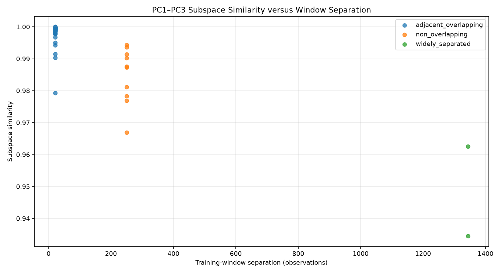
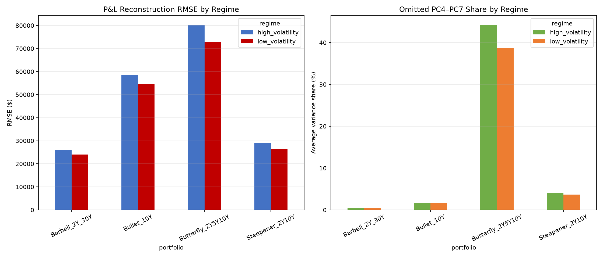

# Treasury PCA Risk Attribution

An independent quantitative research investigation of U.S. Treasury yield-curve risk. The central question is:

> Why can PCA explain most overall Treasury yield-change variance without explaining the P&L of every portfolio equally well?

That distinction matters for risk attribution. A yield curve may move in a low-dimensional way overall, while a portfolio’s DV01 pattern emphasizes smaller, higher-order curve movements. This project tests that idea using public Treasury data and four hypothetical key-rate portfolios. It evaluates historical reconstruction, not trading profitability or forecasting ability.

## Key findings

Covariance PCA on daily changes in seven Treasury maturities explains **98.91%** of overall yield-change variance with PC1–PC3:

- PC1: 87.91%
- PC2: 9.89%
- PC3: 1.11%

But on the same 250-day rolling, 21-day non-overlapping walk-forward design, PC1–PC3 explain only **65.86%** of the butterfly portfolio’s P&L variance. The other three portfolios are much better represented:

| Hypothetical portfolio | Full-sample PC1–PC3 explained | Walk-forward explained | Walk-forward OOS R² | Walk-forward RMSE |
| --- | ---: | ---: | ---: | ---: |
| 10Y bullet | 98.88% | 98.86% | 0.989 | $56,530 |
| 2Y/30Y barbell | 99.73% | 99.71% | 0.997 | $24,907 |
| 2Y/10Y steepener | 97.71% | 97.65% | 0.977 | $27,660 |
| 2Y/5Y/10Y butterfly | 70.18% | **65.86%** | 0.659 | **$76,528** |

The butterfly is not simply noisier in dollar terms; its relative reconstruction error is also much higher. Its omitted PC4–PC7 factor share is approximately 41% in the baseline walk-forward analysis, compared with 0.5%–3.8% for the other portfolios. The evidence supports a portfolio-specific risk-attribution conclusion: high yield-panel variance explained is not sufficient evidence that a chosen portfolio’s P&L is well explained.

### Robustness of the butterfly result

The finding persists across pre-specified training windows evaluated on the same 2,457 test observations:

| Training window | Butterfly explained | RMSE | OOS R² |
| ---: | ---: | ---: | ---: |
| 125 days | 64.21% | $78,786 | 0.643 |
| 250 days | 65.65% | $77,193 | 0.657 |
| 500 days | 66.15% | $76,631 | 0.662 |

Higher-order factors matter materially. In the full 250-day test sample, butterfly explained variance rises from 65.86% with PC1–PC3 to 70.37% with PC1–PC4 and 86.19% with PC1–PC5; all seven components reconstruct numerically to 100%. Excluding the largest 1% of absolute butterfly P&L observations changes PC1–PC3 explained variance to 63.12%, so the result is not caused by a small number of extreme days.

Volatility-regime analysis gives the same qualitative result. Under the ex-ante median-threshold rule, butterfly explained variance is 63.82% in high volatility and 67.82% in low volatility; normalized RMSE is 0.601 and 0.567, respectively. A 75th-percentile sensitivity rule gives 60.15% versus 68.09%. Absolute errors are larger in high volatility partly because P&L volatility is larger, but normalized error also deteriorates for the butterfly.

### Factor stability: local continuity is not global stability

The previously reported 0.9991 mean PC1–PC3 subspace similarity is reproducible for adjacent rolling windows, but neighboring 250-day windows share **229 of 250 observations**. It therefore measures local continuity more than independent historical stability.

Sign- and permutation-invariant comparisons show:

| Window comparison | PC1–PC3 subspace similarity | PC3 loading similarity |
| --- | ---: | ---: |
| Adjacent overlapping windows | 0.9991 | 0.9967 |
| Non-overlapping 250-day windows | 0.9848 | 0.9490 |
| Widely separated windows | 0.9485 | 0.7902 |

PC1 is the most stable individual factor and PC3 the least stable. The defensible conclusion is that the PCA basis is locally persistent but not globally invariant.

### Uncertainty

A 2,000-repetition block bootstrap over complete 21-day test blocks gives a 95% interval of **62.68%–68.65%** for butterfly explained variance. The mean explained-variance gap between the other three portfolios and the butterfly is 32.88 percentage points, with a block-bootstrap interval of **30.08–36.05 percentage points**. The RMSE excess is approximately $40,166, with an interval of **$37,088–$43,446**. These intervals preserve within-block dependence but assume blocks are exchangeable and do not eliminate concerns about regime persistence or structural breaks.

## Visual evidence


The scree plot shows why PC1–PC3 provide a compact description of the seven-tenor yield panel. It does not imply that every portfolio P&L has the same explained-variance profile.



This audit chart compares subspace similarity across window separations. The decline for non-overlapping and widely separated windows qualifies the adjacent-window stability result.



The regime chart compares reconstruction error with omitted PC4–PC7 exposure. The butterfly remains the outlier in both volatility groups.

## Step 6: portfolio-specific factor selection

Step 6 asks whether selecting factors from portfolio P&L improves out-of-sample attribution relative to selecting factors from overall yield variance. All methods use the same 129 test blocks, training-only PCA fits, and training means. `yield_95` and `yield_99` select the smallest consecutive PC1–PCk set meeting a yield-variance threshold; `portfolio_95` and `portfolio_99` apply the same rule to each portfolio’s training P&L variance.

| Butterfly strategy | OOS explained variance | RMSE | Average selected factors |
| --- | ---: | ---: | ---: |
| Fixed 3 factors | 65.86% | $76,528 | 3.00 |
| Yield variance ≥95% | 15.79% | $120,194 | 2.00 |
| Yield variance ≥99% | 72.36% | $68,863 | 3.93 |
| Portfolio P&L variance ≥95% | **98.62%** | **$15,358** | 5.64 |
| Portfolio P&L variance ≥99% | **99.79%** | **$6,007** | 6.30 |

The 95% yield-variance rule underrepresents butterfly P&L risk because it selects two factors in every rolling window. Portfolio-aware selection chooses substantially more factors for the butterfly and improves reconstruction in both volatility regimes. The improvement must be read alongside model complexity: the butterfly uses 5.64 factors on average at the 95% portfolio threshold and 6.30 at 99%, versus three fixed factors; the all-seven model is a saturated reconstruction check. Portfolio-aware selection is therefore not uniformly superior—its 95% version is worse than fixed three factors for the bullet and barbell—and the result is not evidence that it forecasts returns or produces a trading strategy. Paired block-bootstrap intervals for the butterfly versus fixed three factors support the large in-sample-training/out-of-sample-test reconstruction differences, but do not remove the underlying sample and selection limitations. Detailed outputs are in [`step6_strategy_summary.csv`](./results/step6_strategy_summary.csv), [`step6_factor_count_distribution.csv`](./results/step6_factor_count_distribution.csv), [`step6_regime_strategy_summary.csv`](./results/step6_regime_strategy_summary.csv), and [`step6_paired_bootstrap_ci.csv`](./results/step6_paired_bootstrap_ci.csv).

## Methodology and limitations

The project uses the U.S. Department of the Treasury’s public [Daily Treasury Par Yield Curve Rates](https://home.treasury.gov/resource-center/data-chart-center/interest-rates/TextView?type=daily_treasury_yield_curve), covering January 2015 through the latest downloaded date. It retains 2Y, 3Y, 5Y, 7Y, 10Y, 20Y, and 30Y yields. Yields are in percent; changes are in basis points. Missing observations are not imputed.

The primary PCA is covariance-based: daily yield changes are centered but not standardized to unit variance. For centered change matrix (X),

\[
\Sigma = \frac{X^\top X}{n-1}.
\]

The four portfolios are synthetic DV01 vectors in USD per bp:

| Portfolio | DV01 profile |
| --- | --- |
| 10Y bullet | +$100,000 at 10Y |
| 2Y/30Y barbell | +$50,000 at 2Y and +$50,000 at 30Y |
| 2Y/10Y steepener | +$50,000 at 2Y and -$50,000 at 10Y |
| 2Y/5Y/10Y butterfly | +$50,000 at 2Y, -$100,000 at 5Y, and +$50,000 at 10Y |

Daily first-order P&L is `-sum(DV01_i * yield change_i in bp)`. Walk-forward PCA uses only the preceding 250 trading days and projects the next non-overlapping 21-day block. The Step 5 baseline volatility label is also assigned from that preceding training window only.

Explained P&L variance is `1 - Var(reconstruction error) / Var(actual P&L)`. OOS R² uses the training-window mean P&L as the benchmark. Neither statistic is a return forecast. PCA sign ambiguity is handled with sign- and permutation-invariant comparisons; PC1–PC3 subspace similarity uses principal-angle cosines.

Important limitations include synthetic exposures, linear DV01 approximation, omitted carry/roll-down/convexity/transaction costs, sample-dependent PCA, simplified par-yield inputs, and historical rather than prospective evaluation. The detailed audit, definitions, assertions, robustness tables, and limitations are in [`RESEARCH_VALIDATION.md`](./RESEARCH_VALIDATION.md).

## Reproducibility

```bash
python -m venv .venv
source .venv/bin/activate
python -m pip install -r requirements.txt
python scripts/01_explore_data.py
python scripts/02_run_pca.py
python scripts/03_run_pnl_attribution.py
python scripts/04_walk_forward_pca.py
python scripts/05_regime_stability.py
python scripts/05_quality_review.py
python scripts/06_portfolio_factor_selection.py
```

Primary numerical outputs are in [`results/`](./results/), including the PCA, attribution, walk-forward, regime, and quality-review CSVs. The original [`figures/portfolio_risk.py`](./figures/portfolio_risk.py) example and prior research outputs are preserved.

## Attribution

The workflow was informed by the public [yield-curve-pca repository by GasparCoquet](https://github.com/GasparCoquet/yield-curve-pca), which uses public Treasury par yields and walk-forward curve-factor analysis. This project’s implementation and portfolio attribution are original and do not copy external source code. The U.S. Treasury remains the data authority.
