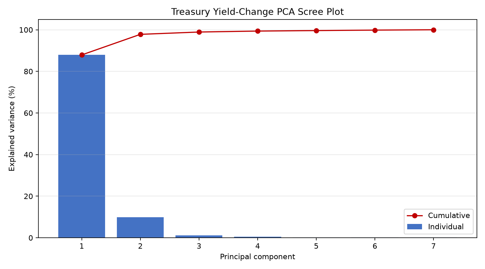

# Treasury PCA Risk Attribution

An independent quantitative research project on U.S. Treasury yield-curve risk. The completed work covers data preparation, covariance PCA, synthetic key-rate DV01 P&L attribution, and rolling walk-forward evaluation. Step 5 has not been implemented.

## Research overview

### How effectively can PCA capture U.S. Treasury yield-curve movements and explain portfolio P&L across different key-rate DV01 exposures?

This matters because interest-rate portfolios are exposed to combinations of maturities, not just one benchmark yield. PCA offers a compact description of common curve movements; P&L attribution tests whether that description is equally useful for different risk profiles. The important distinction is between explaining historical risk and predicting future returns: this project evaluates the former.

## Key findings

The strongest result is portfolio-dependent. Three factors describe nearly all of the historical P&L variance for the 10Y bullet, 2Y/30Y barbell, and 2Y/10Y steepener. They are materially less complete for the 2Y/5Y/10Y butterfly, whose exposure is concentrated in higher-order curve movements.

### Yield-curve PCA

Covariance PCA on daily changes in seven Treasury par yields explains:

- PC1: **87.91%** of yield-change variance
- PC2: **9.89%**
- PC3: **1.11%**
- PC1–PC3 combined: **98.91%**

The leading factors are empirical loading patterns across 2Y, 3Y, 5Y, 7Y, 10Y, 20Y, and 30Y maturities. The project does not assign the labels “level,” “slope,” or “curvature” without inspecting those loadings. Component signs are arbitrary, so the economically meaningful objects are the loading shapes and reconstructed movements.

### Portfolio attribution: in sample versus walk forward

The table reports verified results from the Step 3 full-sample attribution and Step 4 rolling evaluation. “Explained” means the percentage of portfolio P&L variance captured by the PC1–PC3 reconstruction. RMSE is the reconstruction error in USD of first-order daily P&L.

| Hypothetical portfolio | Step 3 in-sample explained | Step 3 RMSE | Step 4 walk-forward explained | Step 4 RMSE |
| --- | ---: | ---: | ---: | ---: |
| 10Y bullet | 98.88% | $56,214 | 98.86% | $56,530 |
| 2Y/30Y barbell | 99.73% | $23,533 | 99.71% | $24,907 |
| 2Y/10Y steepener | 97.71% | $27,267 | 97.65% | $27,660 |
| 2Y/5Y/10Y butterfly | 70.18% | $71,772 | 65.86% | $76,528 |

The first three portfolios show only a small deterioration when PCA is refit through time. The butterfly falls by approximately 4.32 percentage points out of sample and its RMSE rises by approximately $4,756. This indicates that its three-factor representation is less stable and less complete—not that the portfolio is profitable or unprofitable.

The diagnostic is its exposure to PC4–PC7. Average rolling variance shares in those omitted factors are 1.75% for the bullet, 0.48% for the barbell, 3.84% for the steepener, and **41.36% for the butterfly**. The butterfly’s long-wing/short-belly DV01 pattern is therefore sensitive to curve shapes that PC1–PC3 do not capture. A high yield-panel cumulative PCA percentage should not be assumed to transfer equally to every portfolio’s P&L.

These results are historical reconstruction statistics. Step 4 is out of sample relative to each block’s training window, but it is not a live forecast, trading strategy, hedge test, or profitability study.

## Visual evidence



The scree plot shows the concentration of daily yield-change variance in the leading components. It supports dimensionality reduction for the yield panel, but not by itself for every portfolio.


The in-sample attribution makes the portfolio dependence visible: PC1–PC3 capture most P&L variance for the bullet, barbell, and steepener, while the butterfly retains a substantially larger residual.


The rolling factor profile explains the butterfly result directly. Its omitted PC4–PC7 share is much larger than for the other portfolios, so retaining only three factors leaves more of its P&L unexplained.

## Methodology and limitations

### Data

Step 1 uses the U.S. Department of the Treasury’s public [Daily Treasury Par Yield Curve Rates](https://home.treasury.gov/resource-center/data-chart-center/interest-rates/TextView?type=daily_treasury_yield_curve), covering January 2015 through the latest downloaded date. The analysis keeps seven maturities: 2Y, 3Y, 5Y, 7Y, 10Y, 20Y, and 30Y.

Yields are stored in percent; daily changes are stored in basis points. Missing observations are not interpolated, forward-filled, backward-filled, or silently imputed. The cleaned inputs are [`treasury_par_yields.csv`](./data/treasury_par_yields.csv) and [`treasury_daily_changes_bp.csv`](./data/treasury_daily_changes_bp.csv).

### PCA

The primary model is covariance PCA. Daily changes are centered but maturities are not standardized to unit variance. For centered change matrix (X), PCA decomposes the sample covariance matrix

\[
\Sigma = \frac{X^\top X}{n-1}
\]

into eigenvectors and eigenvalues. Eigenvectors are maturity loading patterns; eigenvalues determine explained variance. Step 2 outputs the covariance matrix, explained variance, loadings, factor scores, reconstruction errors, and verification metrics in [`results/`](./results/).

### Synthetic portfolios and P&L

All exposures are hypothetical DV01 vectors in USD per basis point:

| Portfolio | DV01 profile |
| --- | --- |
| 10Y bullet | +$100,000 at 10Y |
| 2Y/30Y barbell | +$50,000 at 2Y and +$50,000 at 30Y |
| 2Y/10Y steepener | +$50,000 at 2Y and -$50,000 at 10Y |
| 2Y/5Y/10Y butterfly | +$50,000 at 2Y, -$100,000 at 5Y, and +$50,000 at 10Y |

Positive DV01 denotes long-duration exposure. Daily first-order P&L is

`P&L = -sum(DV01_i * daily yield change_i in bp)`.

Step 3 projects the full cleaned sample onto the fitted PCA basis. Step 4 fits PCA only on the preceding 250 trading days, then projects the next non-overlapping 21-trading-day test block using the training mean and loadings. The process repeats through the sample; 129 full test blocks and 2,709 test observations were evaluated.

For Step 4, explained P&L variance is `1 - Var(reconstruction error) / Var(actual P&L)`. It is distinct from yield-curve explained variance. PC1–PC3 contributions plus the residual reconstruct actual P&L to floating-point tolerance. The residual includes the omitted reconstruction component and the training-mean P&L needed for exact additive attribution.

### Limitations

- DV01 exposures are synthetic, not actual bonds or tradable positions.
- First-order P&L omits convexity, carry, roll-down, financing, liquidity, transaction costs, and changing instrument DV01.
- PCA is sample-dependent; rolling loadings and factor importance can change, and component signs can flip without changing the reconstruction.
- Walk-forward evaluation is out of sample relative to each training window, but it is still a historical procedure evaluation rather than a prospective live test.
- Par yields at seven maturities are a simplified representation of a bond portfolio and do not constitute security-level valuation.

The ongoing research may later examine higher-component attribution, alternative windows, security-level pricing, uncertainty estimates, or genuinely prospective tests. Those experiments are not claimed here as completed.

## Reproducibility

```bash
python -m venv .venv
source .venv/bin/activate
python -m pip install -r requirements.txt
python scripts/01_explore_data.py
python scripts/02_run_pca.py
python scripts/03_run_pnl_attribution.py
python scripts/04_walk_forward_pca.py
```

Key outputs:

- [`results/pca_explained_variance.csv`](./results/pca_explained_variance.csv)
- [`results/pnl_attribution_summary.csv`](./results/pnl_attribution_summary.csv)
- [`results/walk_forward_summary.csv`](./results/walk_forward_summary.csv)
- [`results/walk_forward_factor_variance.csv`](./results/walk_forward_factor_variance.csv)

The original [`figures/portfolio_risk.py`](./figures/portfolio_risk.py) example is preserved and is unrelated to the PCA attribution pipeline.

## Attribution

The workflow was informed by the public [yield-curve-pca repository by GasparCoquet](https://github.com/GasparCoquet/yield-curve-pca), which uses public Treasury par yields and walk-forward curve-factor analysis. This project’s implementation and portfolio attribution are original and do not copy external source code. The U.S. Treasury remains the data authority.
