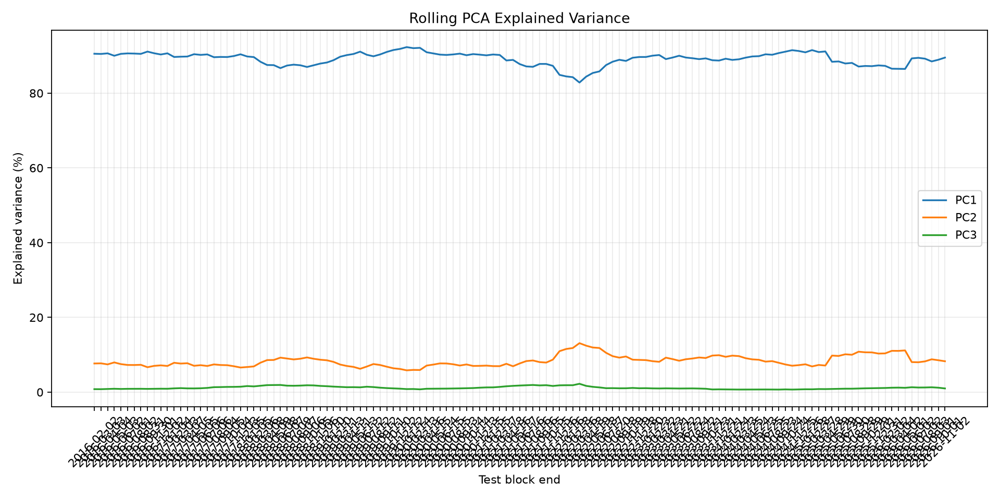
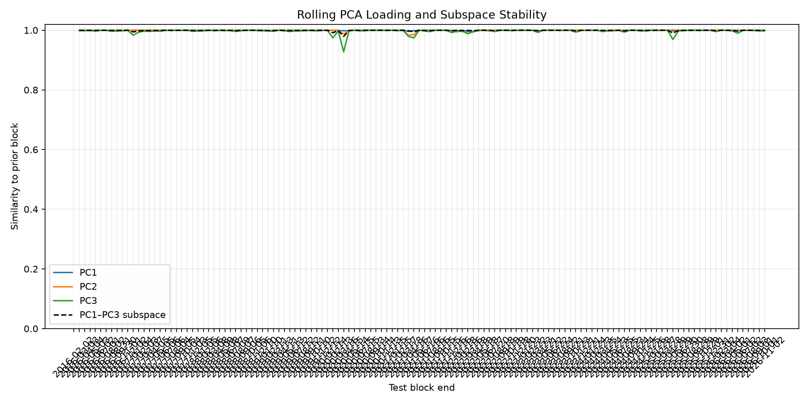

# Treasury PCA Risk Attribution

An independent quantitative research project on U.S. Treasury yield-curve risk. The completed phase covers public-data preparation, covariance PCA, synthetic key-rate DV01 P&L attribution, rolling out-of-sample evaluation, and PCA factor-stability analysis across training-only volatility regimes. Step 5 is the current endpoint; later experiments are not implemented.

## Research overview

### How effectively can PCA capture U.S. Treasury yield-curve movements and explain portfolio P&L across different key-rate DV01 exposures?

This matters because interest-rate portfolios are exposed to combinations of maturities, not just one benchmark yield. PCA can compress correlated yield changes into a few factors, but a high percentage of yield variance explained does not guarantee that every portfolio’s P&L is equally well described. This project tests that distinction directly.

The conclusion so far is portfolio-dependent: three factors describe nearly all historical P&L variance for the 10Y bullet, 2Y/30Y barbell, and 2Y/10Y steepener, while the 2Y/5Y/10Y butterfly retains materially more higher-order exposure. The project measures historical risk reconstruction; it does not claim trading profitability or predictive ability.

## Key findings

### Yield-curve PCA

Covariance PCA on daily changes in seven Treasury par yields explains:

- PC1: **87.91%** of yield-change variance
- PC2: **9.89%**
- PC3: **1.11%**
- PC1–PC3 combined: **98.91%**

The factors are empirical loading patterns across 2Y, 3Y, 5Y, 7Y, 10Y, 20Y, and 30Y maturities. The analysis does not impose the labels “level,” “slope,” or “curvature.” PCA signs are arbitrary; loading shapes, subspaces, and reconstructed movements are the stable objects.

### In-sample versus walk-forward P&L attribution

The table reports verified Step 3 full-sample results and Step 4 rolling results. “Explained” is the percentage of portfolio P&L variance captured by the PC1–PC3 reconstruction. RMSE is the reconstruction error in USD of first-order daily P&L.

| Hypothetical portfolio | Step 3 in-sample explained | Step 3 RMSE | Step 4 walk-forward explained | Step 4 RMSE |
| --- | ---: | ---: | ---: | ---: |
| 10Y bullet | 98.88% | $56,214 | 98.86% | $56,530 |
| 2Y/30Y barbell | 99.73% | $23,533 | 99.71% | $24,907 |
| 2Y/10Y steepener | 97.71% | $27,267 | 97.65% | $27,660 |
| 2Y/5Y/10Y butterfly | 70.18% | $71,772 | 65.86% | $76,528 |

The first three portfolios show only modest deterioration when PCA is refit through time. The butterfly falls by approximately 4.32 percentage points out of sample and its RMSE rises by approximately $4,756. This is evidence of a less complete low-dimensional risk representation, not evidence of a trading opportunity or loss.

### Step 5: factor stability and regimes

Step 5 uses the same 250-trading-day training windows and non-overlapping 21-trading-day test blocks as Step 4. Each test block is classified using only its training window: calculate the trailing 21-day root-mean-square curve volatility, compare it with the median of all available trailing 21-day RMS values in that training window, and label the block high or low volatility. The sample contains 61 high-volatility and 68 low-volatility test blocks.

Across adjacent rolling PCA fits, mean sign- and permutation-adjusted loading similarity is **0.9997 for PC1**, **0.9990 for PC2**, and **0.9967 for PC3**. Mean PC1–PC3 subspace similarity is **0.9991**. PC1 is therefore the most stable individual factor, while PC3 shows the most movement; the three-factor subspace remains highly stable overall.

Stability is somewhat weaker in high-volatility blocks: PC3 loading similarity is 0.9952 in high volatility versus 0.9980 in low volatility, and PC1–PC3 subspace similarity is 0.9987 versus 0.9994. These are statistical associations in this sample, not causal evidence that volatility mechanically changes the curve structure.

The butterfly remains the most difficult portfolio to reconstruct in both regimes:

| Portfolio | Regime | OOS explained | RMSE | Average PC4–PC7 share |
| --- | --- | ---: | ---: | ---: |
| 10Y bullet | High volatility | 98.82% | $58,545 | 1.75% |
| 10Y bullet | Low volatility | 98.89% | $54,659 | 1.75% |
| 2Y/30Y barbell | High volatility | 99.69% | $25,902 | 0.46% |
| 2Y/30Y barbell | Low volatility | 99.72% | $23,981 | 0.51% |
| 2Y/10Y steepener | High volatility | 97.28% | $28,961 | 4.08% |
| 2Y/10Y steepener | Low volatility | 97.94% | $26,438 | 3.63% |
| 2Y/5Y/10Y butterfly | High volatility | 63.82% | $80,315 | 44.26% |
| 2Y/5Y/10Y butterfly | Low volatility | 67.82% | $72,964 | 38.75% |

The butterfly’s PC4–PC7 share is larger in both regimes and rises in the high-volatility group. The data support the observation that its long-wing/short-belly DV01 pattern is more exposed to omitted curve shapes; they do not establish why that relationship exists economically.

## Visual evidence



The rolling explained-variance chart shows how the relative importance of PC1–PC3 changes across the sample. It is a diagnostic of model structure, not a forecast signal.



The stability chart uses absolute, permutation-adjusted loading similarity and PC1–PC3 subspace similarity. This prevents arbitrary sign flips or component reordering from being misread as economic instability.


The regime comparison places reconstruction RMSE beside omitted PC4–PC7 variance share. The butterfly is the clear outlier in both volatility groups, with a larger error and much more higher-order exposure.

## Methodology and limitations

### Data

Step 1 uses the U.S. Department of the Treasury’s public [Daily Treasury Par Yield Curve Rates](https://home.treasury.gov/resource-center/data-chart-center/interest-rates/TextView?type=daily_treasury_yield_curve), covering January 2015 through the latest downloaded date. Yields are stored in percent and daily changes in basis points. Missing observations are not interpolated, forward-filled, backward-filled, or silently imputed.

### PCA and portfolio P&L

The primary model is covariance PCA: daily yield changes are centered, but maturities are not standardized to unit variance. For centered change matrix (X), the sample covariance matrix is

\[
\Sigma = \frac{X^\top X}{n-1}.
\]

All portfolios are hypothetical DV01 vectors in USD per basis point. Positive DV01 denotes long-duration exposure, and daily first-order P&L is `-sum(DV01_i * daily yield change_i in bp)`.

| Portfolio | DV01 profile |
| --- | --- |
| 10Y bullet | +$100,000 at 10Y |
| 2Y/30Y barbell | +$50,000 at 2Y and +$50,000 at 30Y |
| 2Y/10Y steepener | +$50,000 at 2Y and -$50,000 at 10Y |
| 2Y/5Y/10Y butterfly | +$50,000 at 2Y, -$100,000 at 5Y, and +$50,000 at 10Y |

Step 4 and Step 5 fit PCA only on the preceding 250 observations and project the next non-overlapping 21-day block using the training mean and loadings. Step 5’s regime label is known before the test block because it uses no test-block yield changes or P&L. Component alignment uses absolute loading similarity and one-to-one permutation matching; PC1–PC3 subspace similarity is computed from principal-angle cosines.

Explained P&L variance is `1 - Var(reconstruction error) / Var(actual P&L)`. It is distinct from yield-panel explained variance. PC1–PC3 contributions plus the residual reconstruct actual P&L to floating-point tolerance. These are descriptive risk statistics, not live forecasts, hedge results, or trading returns.

Important limitations:

- DV01 exposures are synthetic, not actual bonds or tradable positions.
- First-order P&L omits convexity, carry, roll-down, financing, liquidity, transaction costs, and changing instrument DV01.
- PCA is sample-dependent; rolling loadings and factor importance can change, and component signs can flip without changing the model.
- The high/low regime rule is one volatility definition, and the two groups may differ in frequency, severity, and other market characteristics.
- Walk-forward evaluation is out of sample relative to each training window, but remains a historical procedure evaluation rather than a prospective live test.
- Seven par-yield maturities are a simplified representation of a bond portfolio and do not constitute security-level valuation.

Potential future work includes higher-component attribution, alternative regime definitions, alternative window lengths, security-level pricing with carry and convexity, uncertainty estimates, and genuinely prospective evaluation. Those experiments are not implemented here.

## Reproducibility

```bash
python -m venv .venv
source .venv/bin/activate
python -m pip install -r requirements.txt
python scripts/01_explore_data.py
python scripts/02_run_pca.py
python scripts/03_run_pnl_attribution.py
python scripts/04_walk_forward_pca.py
python scripts/05_regime_stability.py
```

Step 5 numerical outputs are in [`results/`](./results/):

- [`step5_rolling_pca_stability.csv`](./results/step5_rolling_pca_stability.csv)
- [`step5_regime_summary.csv`](./results/step5_regime_summary.csv)
- [`step5_portfolio_regime_attribution.csv`](./results/step5_portfolio_regime_attribution.csv)
- [`step5_block_diagnostics.csv`](./results/step5_block_diagnostics.csv)
- [`step5_daily_attribution.csv`](./results/step5_daily_attribution.csv)
- [`step5_verification.csv`](./results/step5_verification.csv)

The original [`figures/portfolio_risk.py`](./figures/portfolio_risk.py) example and all prior Step 1–4 data, scripts, figures, and results are preserved.

## Attribution

The workflow was informed by the public [yield-curve-pca repository by GasparCoquet](https://github.com/GasparCoquet/yield-curve-pca), which uses public Treasury par yields and walk-forward curve-factor analysis. This project’s implementation and portfolio attribution are original and do not copy external source code. The U.S. Treasury remains the data authority.
