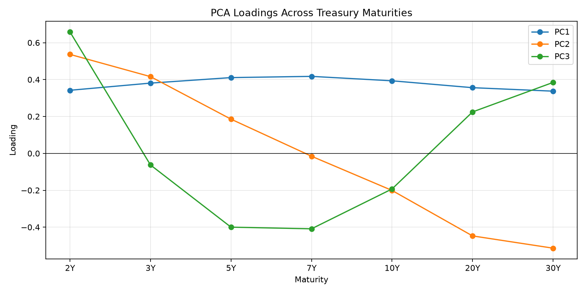
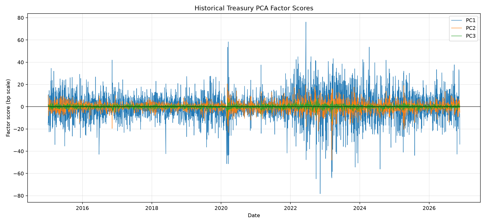
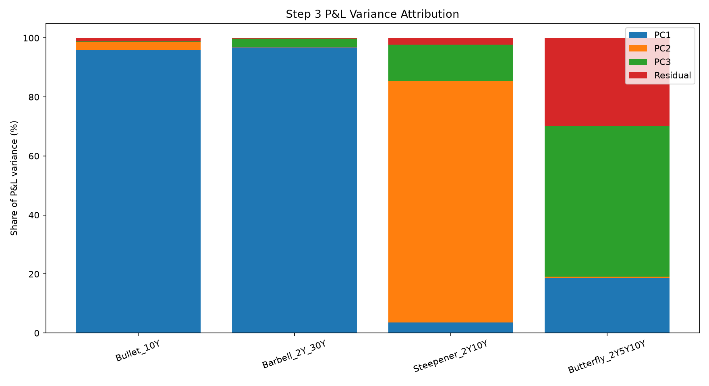
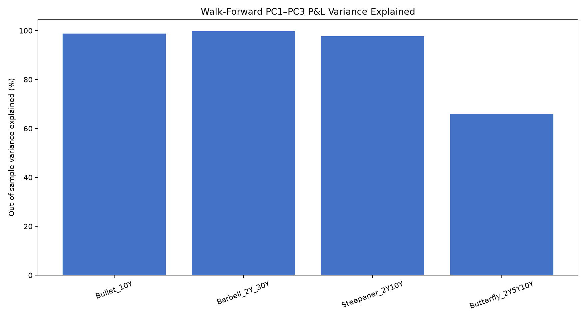
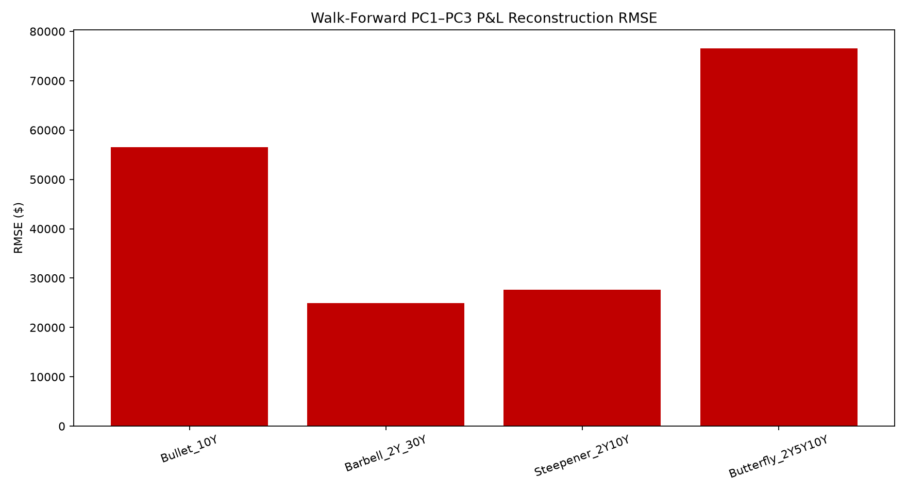
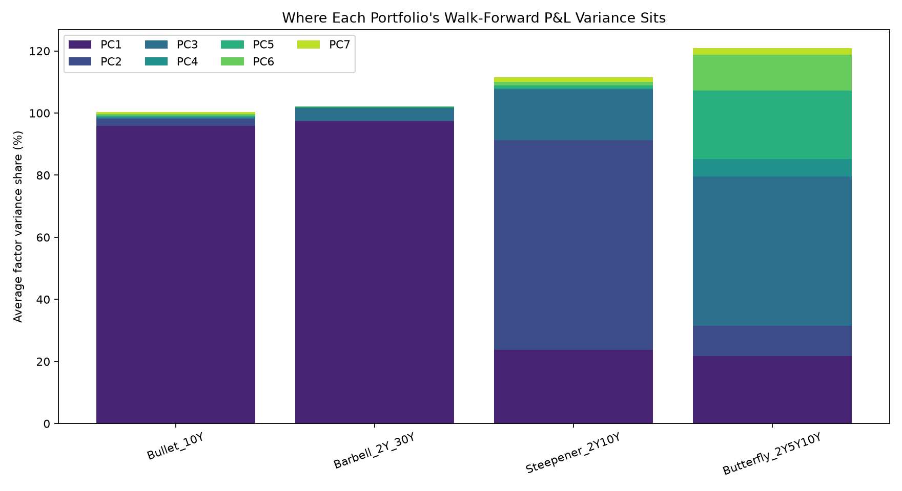
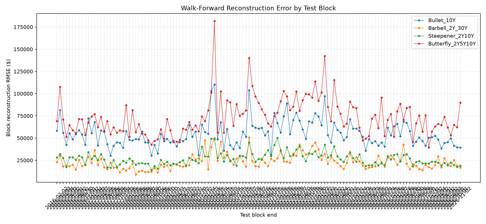

# Treasury PCA Risk Attribution

This project studies how daily movements in the U.S. Treasury par-yield curve affect simple hypothetical key-rate portfolios. It asks two related questions:

1. Can a small number of covariance-based principal components describe most daily yield-curve variation?
2. How much of the first-order P&L of different DV01 profiles can those same factors reconstruct, both in sample and in rolling historical tests?

The project is descriptive risk attribution. It does not claim trading profitability, forecast accuracy, or hedge effectiveness.

## Project overview

Yield-curve portfolios are exposed to several maturities at once. A 10Y bullet, a long 2Y/30Y barbell, and a 2Y/5Y/10Y butterfly can have very different P&L even on the same day because their DV01 profiles weight curve movements differently. PCA provides a compact, data-driven basis for describing those movements.

The workflow uses seven Treasury maturities—2Y, 3Y, 5Y, 7Y, 10Y, 20Y, and 30Y—and proceeds in four completed steps:

- Step 1 downloads and cleans official Treasury par yields, preserves missing observations as missing, calculates daily changes in basis points, and explores the sample.
- Step 2 fits covariance PCA to complete daily yield-change observations without standardizing maturities to unit variance.
- Step 3 attributes synthetic portfolio P&L to PC1–PC3 and a residual using the full sample.
- Step 4 refits PCA in a 250-trading-day rolling window and evaluates non-overlapping 21-trading-day test blocks.

Step 5 is intentionally not implemented.

## Data and methodology

### Public data

The input is the U.S. Department of the Treasury’s [Daily Treasury Par Yield Curve Rates](https://home.treasury.gov/resource-center/data-chart-center/interest-rates/TextView?type=daily_treasury_yield_curve). Step 1 requests annual CSV responses from 2015 through the current year, maps Treasury’s changing column labels to standardized tenors, and keeps the seven maturities used throughout this project.

The cleaned files are:

- [`data/treasury_par_yields.csv`](./data/treasury_par_yields.csv): yields in percent.
- [`data/treasury_daily_changes_bp.csv`](./data/treasury_daily_changes_bp.csv): first differences in basis points, where 1 percentage point equals 100 basis points.

Missing values are not interpolated, forward-filled, backward-filled, or otherwise silently imputed. Rows with an invalid date or any missing maturity are excluded from the PCA and attribution calculations and reported by the scripts.

### Covariance PCA

For a centered daily change matrix X, the sample covariance matrix is Sigma = X'X / (n - 1). PCA solves Sigma v_i = lambda_i v_i. The eigenvector v_i is a maturity loading pattern, and the eigenvalue lambda_i is the variance in that direction. The explained-variance ratio is lambda_i / sum(lambda_j). The primary analysis uses covariance PCA, so maturities are centered but not scaled to unit variance.

Component signs are arbitrary: flipping a loading and its scores by -1 leaves the reconstruction and variance unchanged. The code therefore does not impose a financial label such as “level,” “slope,” or “curvature” before inspecting the loadings.

Step 2 produces [`results/pca_explained_variance.csv`](./results/pca_explained_variance.csv), [`results/pca_loadings.csv`](./results/pca_loadings.csv), factor scores, the covariance matrix, reconstruction errors, and verification metrics.

### Synthetic DV01 portfolios and P&L

All portfolios are hypothetical. DV01 is expressed in USD per basis point. Positive DV01 represents a long-duration exposure: if the associated yield rises by 1 bp, first-order P&L is negative. Daily P&L is `-sum(DV01_i * daily yield change_i in bp)`.

| Portfolio | DV01 assumptions (USD/bp) | Interpretation |
| --- | ---: | --- |
| `Bullet_10Y` | +100,000 at 10Y | Long one key rate only |
| `Barbell_2Y_30Y` | +50,000 at 2Y, +50,000 at 30Y | Long the two wings |
| `Steepener_2Y10Y` | +50,000 at 2Y, -50,000 at 10Y | Long short-end duration and short long-end duration |
| `Butterfly_2Y5Y10Y` | +50,000 at 2Y, -100,000 at 5Y, +50,000 at 10Y | Long the wings and short the belly |

Step 3 uses the fitted full-sample PCA model. Step 4 uses only the preceding 250 observations for each PCA fit, centers the 21-day test block using that training mean, projects test changes onto the training loadings, and reconstructs P&L from PC1–PC3. The test blocks do not overlap.

For Step 4, `oos_explained_variance_pct` is 100 times one minus the variance of actual P&L minus its PC1–PC3 reconstruction, divided by actual P&L variance. This is a reconstruction statistic, not a forecast score. `pc123_variance_share_pct` is reported separately as the variance of the sum of the three factor P&Ls divided by total P&L variance. Because rolling fits use different bases and test-block means, this diagnostic need not be exactly 100%. The additive residual includes the training-mean P&L so that PC1 + PC2 + PC3 + residual equals actual P&L to floating-point tolerance.

## Key research findings

The current sample contains 2,973 input rows, of which 2,972 are complete after Step 1 cleaning. Step 2’s full-sample PCA explains 87.91% with PC1, 9.89% with PC2, and 1.11% with PC3—98.91% cumulatively.

The table compares verified Step 3 in-sample results with Step 4’s rolling results. RMSE is in USD of first-order daily P&L.

| Portfolio | Step 3 PC1–PC3 variance explained | Step 3 RMSE | Step 4 explained variance | Step 4 RMSE |
| --- | ---: | ---: | ---: | ---: |
| 10Y bullet | 98.88% | $56,214 | 98.86% | $56,530 |
| 2Y/30Y barbell | 99.73% | $23,533 | 99.71% | $24,907 |
| 2Y/10Y steepener | 97.71% | $27,267 | 97.65% | $27,660 |
| 2Y/5Y/10Y butterfly | 70.18% | $71,772 | 65.86% | $76,528 |

The bullet, barbell, and steepener retain nearly the same attribution quality when the PCA fit is rolled through time. The butterfly is different: its Step 4 explained variance is about 4.32 percentage points lower than its Step 3 result and its RMSE is about $4.8k higher. This is evidence of a less stable low-dimensional description for that DV01 pattern, not evidence of poor trading performance.

The rolling factor-variance diagnostic explains the difference. Average PC4–PC7 shares are 1.75% for the bullet, 0.48% for the barbell, 3.84% for the steepener, and 41.36% for the butterfly. The butterfly’s long-wing/short-belly exposure is therefore much more sensitive to higher-order curve shapes that are omitted when only PC1–PC3 are retained. The result also cautions against treating the first three yield PCs as universally sufficient for every portfolio.

## Visualizations and interpretation


The scree plot shows the concentration of daily yield-change variance in the first three covariance components. This describes the yield panel; it does not automatically imply the same percentage of variance for a particular portfolio’s P&L.



The loading plot shows how each retained factor weights the seven maturities. Loadings are the evidence used to discuss factor shape; their signs are convention-dependent.



The factor-score history shows when the dominant curve-movement directions were unusually large. It is a historical description of daily changes, not a signal or forecast.



The in-sample attribution chart makes the portfolio dependence visible: the first three PCs capture most bullet, barbell, and steepener P&L variance, while the butterfly retains a much larger residual.



The walk-forward comparison shows that the first three factors remain effective for the first three portfolios across rolling historical windows, while the butterfly is more sensitive to the fitted sample and omitted factors.



RMSE expresses the reconstruction miss in dollars rather than percentages. It is affected by the scale of the synthetic DV01 exposure, so it should be read together with explained variance.



The factor profile is the clearest butterfly diagnostic: the omitted PC4–PC7 contribution is much larger for the butterfly than for the other portfolios.



Block-level RMSE shows how reconstruction quality varies through the historical sample. Spikes indicate periods in which the rolling three-factor basis was less adequate for a portfolio; they are not forecasts of future error.

## Limitations and future research

- The portfolios are synthetic DV01 vectors, not actual bonds or tradable positions. They omit carry, roll-down, convexity, liquidity, financing, transaction costs, and instrument-specific DV01 estimation.
- The P&L calculation is a linear first-order approximation. Large yield moves and changes in duration can make actual security P&L differ from the approximation.
- PCA is sample-dependent. Rolling loadings and eigenvalues can change, and component signs can flip without changing the model.
- Step 4 is out of sample relative to each block’s training window, but the full historical period is still used to evaluate the procedure. It is not an independent live forecast, trading backtest, or profitability claim.
- The data are par yields at selected maturities, not a complete bond-level curve or a portfolio valuation system.

Potential future extensions include stability tests with alternative windows, explicit higher-component attribution, security-level pricing with carry and convexity, statistical uncertainty estimates, and genuinely prospective evaluation. Those are not implemented here.

## Reproducibility and attribution

```bash
python -m venv .venv
source .venv/bin/activate
python -m pip install -r requirements.txt
python scripts/01_explore_data.py
python scripts/02_run_pca.py
python scripts/03_run_pnl_attribution.py
python scripts/04_walk_forward_pca.py
```

Project structure:

```text
data/       cleaned public Treasury inputs
src/        reusable PCA and attribution modules
scripts/    reproducible analysis entry points
results/    numerical CSV outputs
figures/    generated charts and the preserved portfolio example
```

The PCA workflow was informed by the public [yield-curve-pca repository by GasparCoquet](https://github.com/GasparCoquet/yield-curve-pca), which also uses public Treasury par yields and walk-forward curve-factor analysis. This project’s code and portfolio-attribution implementation are original and do not copy external source code. The official Treasury source remains the data authority.

The original [`figures/portfolio_risk.py`](./figures/portfolio_risk.py) example is preserved and is not part of the PCA attribution pipeline.
